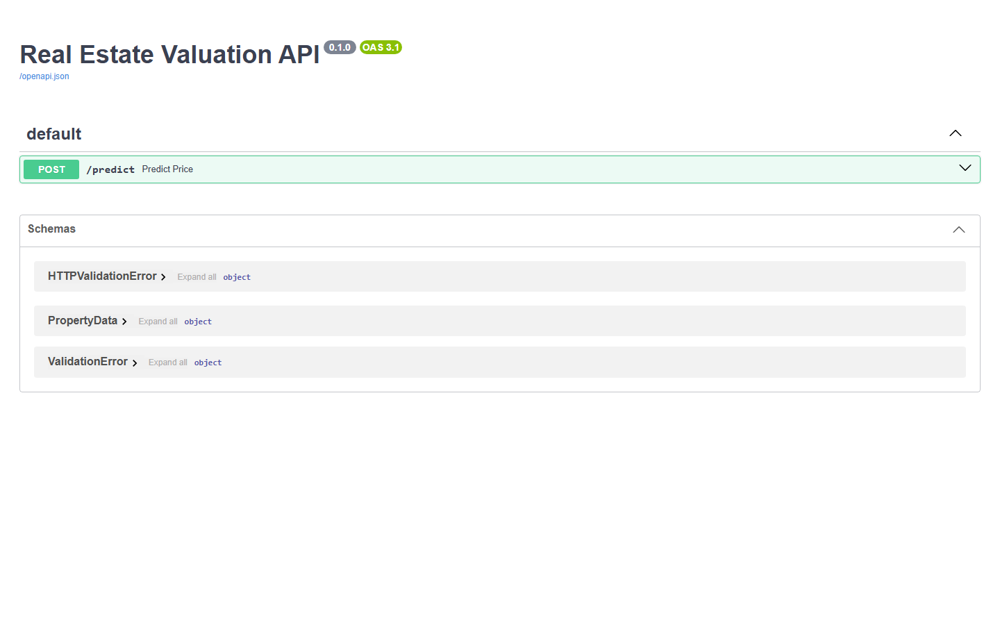
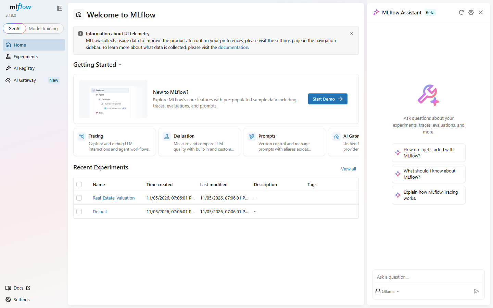

# Real Estate MLOPS

A small but complete end-to-end MLOps project: a pipeline that prepares data, trains a machine learning model
that predicts real estate prices, tracks its experiments with MLflow, and serves the final model
through a REST API.

I built this to practice wiring an ML project together the way it would work in a real production setting —
not just a notebook somewhere, but a reproducible pipeline, experiment tracking, and a live API on top.

## What it does

- **Data prep** — takes raw property listings (`data/raw/properties.csv`) and turns them into a clean train/test split
- **Training** — fits a Random Forest regressor on the cleaned data, logs everything to MLflow, and saves the fine-tuned model to `models/rf_model.pkl`
- **Serving** — FastAPI app loads the saved model and serves predictions on a `/predict` endpoint
- **Reproducibility** — [DVC](https://dvc.org/) ties the whole flow together, so `dvc repro` runs the pipeline end-to-end and only recomputes what actually changed

## Pipeline at a glance

```
data/raw/properties.csv
        │
        ▼
   [ data_prep ]  ──►  data/processed/   (X_train, X_test, y_train, y_test)
        │
        ▼
    [ train ]     ──►  models/rf_model.pkl   +   MLflow experiment tracking
        │
        ▼
  [ FastAPI ]     ──►  POST /predict  → estimated price in USD
```

The model is trained on four simple features: bedrooms, bathrooms, square footage and year built.
It's a starting point, not a Zillow killer — but the plumbing around it is what this project is really about.

### The API in action

Swagger UI generated automatically by FastAPI:



Predictions are served as plain JSON:

```bash
curl -X POST http://localhost:8000/predict \
     -H "Content-Type: application/json" \
     -d '{"bedrooms": 3, "bathrooms": 2, "square_feet": 1500, "year_built": 2005}'
```

```json
{
  "estimated_price": 307862.66,
  "currency": "USD"
}
```

### Experiment tracking

Every training run is automatically logged to MLflow (parameters, metrics, the model itself), so it's easy to
look back and compare runs later:



## Project structure

```
├── app/
│   └── main.py            # FastAPI app that loads the model and serves /predict
├── src/
│   ├── data_prep.py       # Cleaning + train/test split (stage 1)
│   └── train.py           # Random Forest training + MLflow logging (stage 2)
├── scripts/
│   └── make_sample_data.py  # Utility to generate a synthetic dataset
├── dvc.yaml               # The two-stage pipeline definition
├── data/
│   ├── raw/               # Raw input data (properties.csv)
│   └── processed/         # Outputs of the prep stage
├── models/
│   └── rf_model.pkl       # Trained Random Forest model
├── docs/images/           # Screenshots
└── mlruns/                # MLflow tracking data (created on first run)
```

## Getting started

### 1. Install the dependencies

```bash
pip install -r requirements.txt
```

### 2. Get some data

Drop your own CSV at `data/raw/properties.csv` with these columns:
`bedrooms`, `bathrooms`, `square_feet`, `year_built`, `price`.

Or, if you just want to kick the tires, generate a synthetic one:

```bash
python scripts/make_sample_data.py
```

### 3. Run the pipeline

With DVC, which handles the two stages and their dependencies:

```bash
dvc repro
```

Or the old-fashioned way, one stage at a time:

```bash
python src/data_prep.py
python src/train.py
```

When training finishes you'll see the model's Mean Absolute Error printed to the console,
and the run will show up in MLflow.

### 4. (Optional) Open the MLflow UI

```bash
mlflow ui --port 5000
```

Then head to `http://localhost:5000` to browse the runs.

### 5. Serve the model

```bash
uvicorn app.main:app --port 8000
```

Now the API is live. You can hit `POST http://localhost:8000/predict` directly, or open the
interactive docs at `http://localhost:8000/docs` and try it from the browser.

## Things I'd like to add next

- [ ] Data and model versioning with DVC remote storage (S3) — the `dvc.yaml` file is in place, the remote isn't yet
- [ ] A GitHub Actions workflow to run `dvc repro` and tests on every push
- [ ] Containerizing the API with Docker
- [ ] Better features and hyperparameter tuning (the current MAE leaves some room on the table)

## Built with

- [scikit-learn](https://scikit-learn.org/) — the model (Random Forest)
- [MLflow](https://mlflow.org/) — experiment tracking
- [DVC](https://dvc.org/) — pipeline orchestration and reproducibility
- [FastAPI](https://fastapi.tiangolo.com/) — model serving
- pandas, joblib, uvicorn
